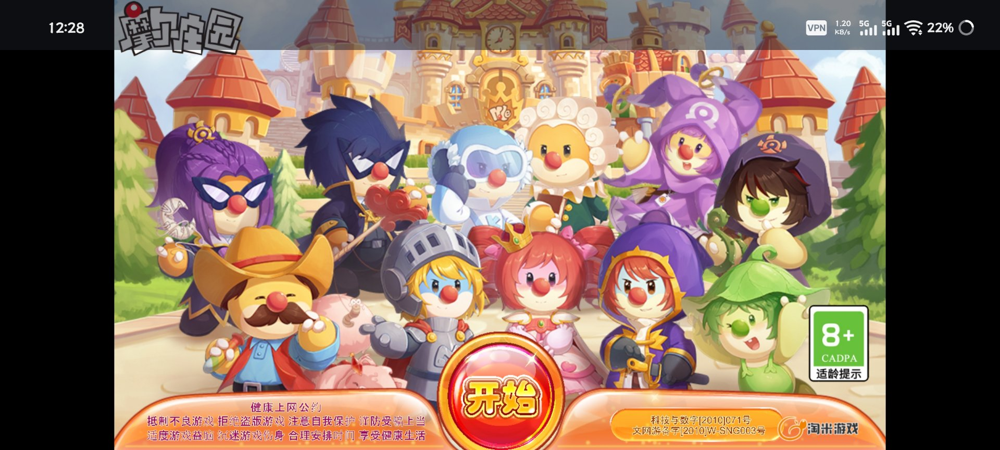
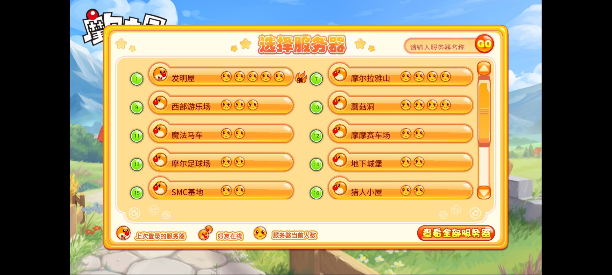
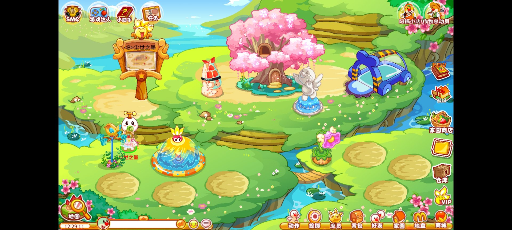

# 摩尔庄园 Flash 客户端 · Android

[](LICENSE)
[](#环境要求)
[](https://ruffle.rs)
[](#已知限制)

一个把**官方网页版 Flash 客户端**塞进 Android WebView、用 [Ruffle](https://ruffle.rs) 运行、再用本地
WebSocket 隧道补上 raw TCP 能力的安卓客户端。

同时它也是一份**兼容层实现笔记**：Ruffle 跑不了 Flash 的 `Socket`、跑不了中文、跑不动高分辨率，
这里逐条记了怎么补、为什么这么补、以及哪些坑是驱动层的、改代码无解。

> 不是官方产品，与上海淘米网络无任何关系。仓库不含任何游戏资源文件。

## 下载

[](https://github.com/Earthink030918/mole-flash-android/releases/latest)

安装包在 [Releases](https://github.com/Earthink030918/mole-flash-android/releases/latest)，当前版本 **v1.0.0**：
`mole-flash-android-1.0.0.apk`，10.1 MB，Android 5.0+，不需要 Root。

```bash
sha256sum -c SHA256SUMS.txt
```

| 版本 | 包名 | 大小 | 签名 | SHA-256（前 12 位） |
| --- | --- | --- | --- | --- |
| v1.0.0 | `com.taomee.mole` | 10,134,939 B | v1 + v2，自签名 | `d167eeeb2d4f` |

> **账号被踢出怎么办** —— 如果提示「账号在其他设备登录」或被踢回登录页，**按一次返回键**即可，
> 不用强杀重开。返回键在壳里走的是 `WebView.goBack()`，正好退回上一层的登录界面，
> 重新登录就能继续。

## 实机截图

| 进入游戏 | 登录 |
| :---: | :---: |
|  |  |

| 选择服务器 | 家园 |
| :---: | :---: |
|  |  |

| 游戏内弹窗 |
| :---: |
|  |

按实际启动顺序排列：开始 → 登录 → 选择服务器 → 家园 → 游戏内弹窗。
截图取自 iQOO Neo9（Android 16），横屏沉浸，上下留黑边来自等比缩放（`contain`），非缺陷。
游戏画面版权归上海淘米网络所有，此处仅作兼容性展示，不构成对游戏内容的分发。


---

## 两种打开方式

**如果你是来玩的** —— 这是完整客户端：横屏沉浸、自动适配分辨率、断线重连、崩溃自动降档。
构建步骤见 [docs/build.md](docs/build.md)。
请注意：**需要键盘辅助的小游戏暂时不支持**，目前正在想办法解决。

**如果你是来看实现的** —— 从 [docs/architecture.md](docs/architecture.md) 开始。四个核心问题各有一章：

| 问题 | 解法 | 位置 |
| --- | --- | --- |
| Flash 的 `Socket` 在浏览器里不存在 | 本地 WebSocket 服务 + Java 侧 TCP 中继 | `SocketBridge` |
| 官方客户端是 24fps，Ruffle 默认 60 → 小游戏"开倍速" | 在 `ruffle.js` 之前装帧率节流器 | `shell.html` §0 |
| 手机 GPU 显存扛不住 1.5K 分辨率 | 三套降载：启动档 / 运行时 DPR / 显存看护 | `MainActivity` |
| AS3 一旦 `scaleMode = NO_SCALE` 就裁切 | 元素尺寸 = 影片原生尺寸，只用 CSS transform 缩放 | `shell.html` §0 |

```
┌──────────────────────────── Android App ────────────────────────────┐
│                                                                     │
│  MainActivity                                                       │
│   ├── WebView ──── shell.html (assets) ── mole_boot.js              │
│   │                 └── Ruffle (ruffle.js + wasm)                   │
│   │                       └── /Client.swf ← upstream 代理取官网 SWF  │
│   ├── SocketBridge  ← 127.0.0.1 WebSocket 服务 → TCP → 游戏服务器    │
│   ├── HttpCache     ← /cache 静态资源落盘（SWF/图片/js/css）         │
│   └── CrashProbe    ← ApplicationExitInfo 判定连续崩溃，自动降档     │
│                                                                     │
└─────────────────────────────────────────────────────────────────────┘
```

## 特性

- **能玩**：网页版整套流程（登录、地图、小游戏）走通，画面与官方电脑微端窗口的呈现一致
- **横屏沉浸**：手机锁横屏，平板/桌面跟传感器；API 30+ 与老版本两套沉浸式实现
- **自适应**：按影片实际分辨率校正容器，再整体缩放，永不裁切、不变形
- **省显存**：6 档像素预算（121万 → 21万），崩溃一次自动降一档；运行时越过 400MB 就地降采样，不重载不掉线
- **离线加速**：静态资源落盘（≤6 MiB），冷启动不再重拉 SWF
- **可诊断**：页面 `console` 全量转发到 logcat，HUD 可开；WebView 远程调试默认可用
- **服务器自动发现**：种子地址连不上时，捕获 Ruffle 的缺失代理告警自动补录并持久化

## 环境要求

| 项 | 要求 |
| --- | --- |
| Android | 5.0（API 21）以上；**实际要求 WebGL 可用的 WebView**，建议 Android 8+ |
| 架构 | arm64-v8a（Ruffle 的 wasm 与架构无关，但 WebView 需要 64 位才够稳定） |
| 内存 | 建议 4GB 以上；低于 2GB 会频繁触发降档 |
| 构建 | JDK 17+、Android SDK 35、Ruffle 二进制（见下） |

## 快速开始

```bash
git clone <this-repo>
cd mole-flash-android

# 1. 放 Ruffle 二进制（不随仓库分发）
#    从 https://github.com/ruffle-rs/ruffle/releases 取 web-selfhosted 包，解压到
#    app/src/main/assets/ruffle/   —— 三个文件必须同版本

# 2. 编译安装
./gradlew assembleDebug
adb install -r app/build/outputs/apk/debug/app-debug.apk

# 3. 看日志
adb logcat -s MoleShell:V MoleSocketBridge:V
```

> 本仓库的 `src/java` 是**反编译产物**，不能直接 `javac` 通过。要先按
> [docs/decompile-report.md](docs/decompile-report.md) 的失真清单人工过一遍，或直接拿它当参考实现重写。

## 目录

```
.
├── docs/
│   ├── architecture.md        启动时序 / 请求路由表 / Socket 桥 / 降载状态机
│   ├── build.md               重建 APK：补 Ruffle、清反编译代码、Gradle 骨架
│   ├── decompile-report.md    工具链、失真清单、未覆盖部分
│   ├── troubleshooting.md     按 logcat 原文的症状对照表
│   ├── classes_inventory.txt  dex 全部类
│   └── strings_urls.txt       dex 中的域名与 URL 字面量
├── src/
│   ├── java/com/taomee/mole/  23 个类的 Java 源码
│   ├── web/                   shell.html + mole_boot.js
│   └── manifest/              AndroidManifest.xml（AXML 解码）
├── third_party/ruffle/        Ruffle 的 MIT / Apache-2.0 许可证原文
├── tools/run_decompile.py     可复现的反编译脚本
└── CONTRIBUTING.md / CHANGELOG.md
```

## 已知限制

- **需要键盘辅助的小游戏暂时不支持**（没有可用的软键盘映射通道），正在想解决方法
- 只处理 `Client.swf` 主链路，子 SWF 靠上游代理直通；某些子游戏帧率不是 24，会被节流器拖慢
- 服务器地址是「种子 + 学习」两段式，种子失效后依赖运行时补录，不保证长期有效
- Adreno 驱动在 wgpu 下过不了某些着色器校验会 panic，只能靠清空重载兜底；这是引擎 + 驱动的问题
- `resources.arsc` 未解析成明文，清单里资源 ID 仍是 `@7F020000` 形式
- Ruffle 二进制、游戏资源都不在仓库内

## 参与

见 [CONTRIBUTING.md](CONTRIBUTING.md)。崩溃报告请务必带 `adb logcat -s MoleShell:V MoleSocketBridge:V` 的片段，
没有日志基本无法定位。

## 许可与声明

本仓库中由作者编写的部分（`src/`、`tools/`）以 [MIT](LICENSE) 发布。
Ruffle 为 MIT / Apache-2.0 双许可，见 [THIRD-PARTY-NOTICES.md](THIRD-PARTY-NOTICES.md)。

**免责声明**：本项目仅供个人在自己的设备上运行已停止官方支持的 Flash 内容之用，与上海淘米网络
及其关联公司无任何关系，未获其授权或认可。"摩尔庄园"及相关商标、游戏本体与美术资源的权利
均归其各自权利人所有，**不在本仓库内，也不随本项目分发**。使用本项目产生的账号风险由使用者自行承担。
