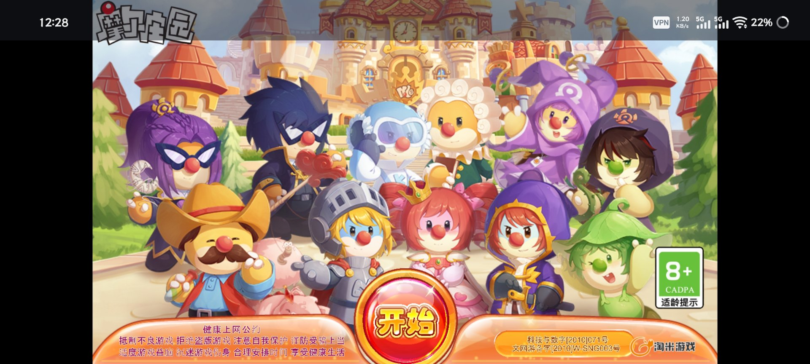
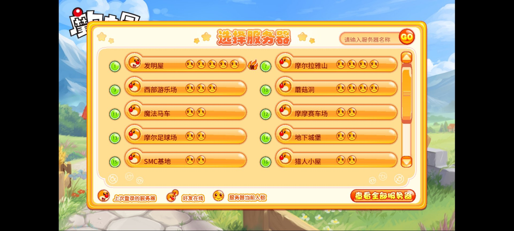
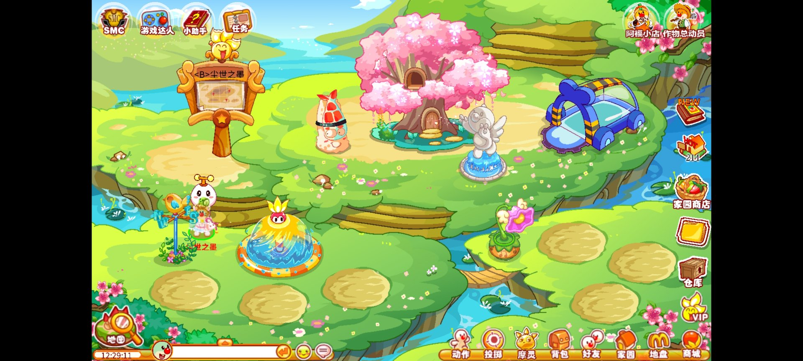

# 摩尔庄园 Flash 客户端 · Android / HarmonyOS

[](LICENSE)
[](https://github.com/Earthink030918/mole-flash-android/releases/latest)
[](#兼容性)
[](https://ruffle.rs)
[](https://github.com/omnipad-js/omnipad)
[](#已知限制)

把**官方网页版 Flash 客户端**装进移动端 WebView，用 [Ruffle](https://ruffle.rs) 跑 ActionScript 3，
再用本地 WebSocket 隧道补上 raw TCP 能力——让一个 2026 年已经没有任何浏览器支持的 Flash 游戏，
在 Android 手机和 HarmonyOS 平板上重新跑起来。

同时它也是一份**兼容层实现笔记**：Ruffle 跑不了 Flash 的 `Socket`、读不了中文、扛不住 1.5K 分辨率、
不认「鼠标悬停」这种只有 PC 才有的交互，这里逐条记了怎么补、为什么这么补、以及哪些坑在驱动层、改代码无解。

> 非官方项目，与上海淘米网络及其关联公司无任何关系，未获授权或认可。
> 仓库不含任何游戏资源文件，游戏本体由客户端在运行时从官方服务器按需加载。

---

## 目录

- [这是什么](#这是什么)
- [功能特性](#功能特性)
- [实机截图](#实机截图)
- [下载与安装](#下载与安装)
  - [Android](#android)
  - [HarmonyOS](#harmonyos)
  - [校验下载](#校验下载)
- [兼容性](#兼容性)
- [工作原理](#工作原理)
- [从源码构建](#从源码构建)
- [目录结构](#目录结构)
- [四个核心问题的解法](#四个核心问题的解法)
- [触控方案：为什么是 OmniPad](#触控方案为什么是-omnipad)
- [已知限制](#已知限制)
- [排障](#排障)
- [版本与更新日志](#版本与更新日志)
- [参与贡献](#参与贡献)
- [许可证](#许可证)
- [第三方组件](#第三方组件)
- [免责声明](#免责声明)

---

## 这是什么

一个**壳（shell）**。里面没有任何游戏代码，只有三样东西：

1. 一份 `shell.html`——负责适配、帧率、时间轴、输入、降载策略；
2. 一份 Ruffle WASM 运行时——真正执行 SWF 的引擎；
3. 一层原生桥——把浏览器里不存在的 `Socket` / raw TCP 接到游戏服务器。

游戏本体（`Client.swf`、地图、角色、道具）始终留在官方服务器上，客户端只在运行时按需拉取、不落盘分发。

**适合谁：**

| 你是 | 从哪看起 |
| --- | --- |
| 想在自己的手机上玩 | [下载与安装](#下载与安装) |
| 想看 Flash 兼容层怎么补 | [四个核心问题的解法](#四个核心问题的解法) |
| 想改、想提 PR | [从源码构建](#从源码构建) + [CONTRIBUTING.md](CONTRIBUTING.md) |
| 遇到问题要报 bug | [排障](docs/troubleshooting.md)（**务必带日志**） |

---

## 功能特性

**能玩**

- 网页版整套流程走通：登录 → 选服 → 家园 → 地图 → 小游戏
- 画面与官方电脑微端窗口的呈现一致：`960x560` 原生画幅、`contain` 等比缩放、多余部分留黑边（不是裁切）

**稳**

- **切后台不掉线**：Ruffle 走 `backgroundExecutionMode: 'mainThread'`，Worker 里按 41.67ms 持续推进，
  回到前台时间轴连续，不会一次性补帧、补定时器，也不会因此触发服务器的时序校验
- **双层时间轴保护**：即使 Worker 起不来，壳层的虚拟时间轴仍会把 `>800ms` 的间隔钳制为「只推进 1 帧」
- **断线重连**：`SocketBridge` 上下行对称关闭 + 有界线程池，避免线程泄漏导致的假死
- **无损纹理回收**：长跑显存吃紧时，用跨帧抖动让 Ruffle 重建渲染目标，**只归还纹理、不降画质**
- **崩溃自动降档**：连续异常启动时逐级下调像素预算（6 档，121 万 → 21 万），不再无限重载

**好操作**

- **虚拟触控板**（[OmniPad](https://github.com/omnipad-js/omnipad)）：黑边里的摇杆式光标控制，专治「悬停才展开」的 PC 交互
- **靶区（TargetZone）**：单指直接点舞台，命中位置精确到像素，穿透 Ruffle 的 Shadow DOM
- **触控板不压画面**：只挂在黑边里，四边都没有余量时自动不显示

**省**

- 静态资源落盘（≤6 MiB），冷启动不再重拉 SWF
- 帧率锁定 24fps（官方客户端同频），避免 Ruffle 默认 60fps 把小游戏跑成「倍速」

**可诊断**

- 页面 `console` 全量转发到 `logcat` / `hilog`，HUD 可开关
- 三个调试口：`__moleClock()`、`__molePad.state()`、`__molePurgeTex()`

---

## 实机截图

| 进入游戏 | 登录 |
| :---: | :---: |
|  |  |

| 选择服务器 | 家园 |
| :---: | :---: |
|  |  |

| 游戏内弹窗 |
| :---: |
|  |

按实际启动顺序排列：开始 → 登录 → 选择服务器 → 家园 → 游戏内弹窗。
截图取自 iQOO Neo9（Android 16），横屏沉浸，上下黑边来自等比缩放（`contain`），非缺陷。
游戏画面版权归上海淘米网络所有，此处仅作兼容性展示，不构成对游戏内容的分发。

---

## 下载与安装

全部产物见 [Releases](https://github.com/Earthink030918/mole-flash-android/releases/latest)。当前版本 **v1.2.0**。

| 平台 | 文件 | 大小 | 系统要求 |
| --- | --- | --- | --- |
| Android | `mole-1.2.0.apk` | 9.88 MiB | Android 5.0（API 21）以上，建议 8+ |
| HarmonyOS | `mole-harmony-1.2.0-signed.hap` | 10.93 MiB | HarmonyOS 5.0.0（API 12）以上 |

### Android

```bash
adb install -r mole-1.2.0.apk
```

或在手机上下载 APK 后直接点开安装（需允许「安装未知来源应用」）。

- 签名证书 SHA-256：`974EA1B9 54845D05 FAECF5D4 568EBDEF 783BBCB5 F929281D EC3D6A71 C0780093`
- 与历史版本 **同签名**，可直接覆盖安装、保留登录态；若提示签名冲突，说明装的是官方原包，需先卸载
- 首次启动会申请网络权限，无其他任何权限

### HarmonyOS

```bash
hdc install mole-harmony-1.2.0-signed.hap
```

或在「文件管理」中打开 HAP 安装。**注意：**

- 本 HAP 使用 OpenHarmony 社区签名（`os_integration`，release 类型），真机安装需设备允许侧载；
  部分华为零售机型会拒绝非应用市场签名的包，这属于系统策略，无法在应用侧绕过
- 包内 `debug` 标志为 `true`（沿用自 1.0.1，便于云调试抓 hilog），签名与功能不受影响

### 校验下载

每个 Release 都附带 `SHA256SUMS.txt`：

```bash
# Linux / macOS
sha256sum -c SHA256SUMS.txt

# Windows PowerShell
Get-FileHash .\mole-1.2.0.apk -Algorithm SHA256
```

v1.2.0 校验值：

```
b776302bbc5ce46c71e773d4425edc2f2bee5fa99d0a13101571e59c57331714  mole-1.2.0.apk
c8b99da639c9f9598898ac2c1822127c7e89024c107d7ff0465442c61e113af5  mole-harmony-1.2.0-signed.hap
```

---

## 兼容性

| 项 | Android | HarmonyOS |
| --- | --- | --- |
| 最低系统 | Android 5.0（API 21） | HarmonyOS 5.0.0（API 12） |
| targetSdk | 35 | 12 |
| 架构 | arm64-v8a（WebView 需 64 位） | arm64-v8a |
| 设备类型 | 手机、平板 | 手机、平板、2in1（`phone` / `tablet` / `2in1`） |
| 屏幕方向 | 手机锁横屏，平板跟传感器 | 横屏（`orientation: landscape`） |
| 关键前提 | **WebView 需支持 WebGL**（Ruffle 必需） | 内置 ArkWeb 内核，无需额外组件 |
| 内存建议 | 4GB 以上；低于 2GB 会频繁触发降档 | 同上 |

**实测过**：iQOO Neo9（Android 16）、一加平板 / ColorOS 17、红米 K90。

---

## 工作原理

```
┌──────────────────────────── 应用进程 ────────────────────────────┐
│                                                                 │
│  MainActivity / EntryAbility                                    │
│   ├── WebView ──── shell.html ── mole_boot.js                   │
│   │                 └── Ruffle (ruffle.js + wasm)               │
│   │                       └── Client.swf ← 经本地代理取官方 SWF  │
│   ├── SocketBridge / LocalServer ← 127.0.0.1 WebSocket → TCP    │
│   ├── HttpCache     ← 静态资源落盘（SWF / 图片 / 音频）          │
│   └── CrashProbe    ← 判定连续崩溃，自动降档                     │
│                                                                 │
└─────────────────────────────────────────────────────────────────┘
```

两端壳层的**行为完全一致**，差异只在宿主语言：

| | Android | HarmonyOS |
| --- | --- | --- |
| 宿主 | `MainActivity`（Java / smali） | `EntryAbility` + `Index.ets`（ArkTS） |
| 页面来源 | `file:///android_asset/ruffle/` | 本地 HTTP 服务 `127.0.0.1:<port>` |
| 原生桥 | `addJavascriptInterface` | `javaScriptProxy` + 自建 `LocalServer` |
| 生命周期 | `onPause` / `onResume` | `onBackground` / `onForeground` |
| 日志 | `logcat -s MoleShell` | `hilog` |

页面里统一通过 `window.MoleBridge` 访问原生能力，所以 `shell.html` **两端同一份文件**，不需要分叉。

---

## 从源码构建

### Android

```bash
git clone https://github.com/Earthink030918/mole-flash-android.git
cd mole-flash-android

# 1) 放 Ruffle 二进制（不随仓库分发）
#    从 https://github.com/ruffle-rs/ruffle/releases 取 web-selfhosted 包，
#    解压 app/src/main/assets/ruffle/ —— 三个文件必须同版本

# 2) 编译安装
./gradlew assembleDebug
adb install -r app/build/outputs/apk/debug/app-debug.apk

# 3) 看日志
adb logcat -s MoleShell:V MoleSocketBridge:V
```

### 从 APK 重建（本仓库实际使用的流程）

本仓库的 `src/java` 是**反编译产物**，不能直接 `javac` 通过。实际改壳层走的是 apktool 路线，
完整步骤见 [docs/build.md](docs/build.md)，要点：

```bash
apktool d base.apk -o dec                     # 解包
# 改 dec/assets/ruffle/shell.html、dec/smali/**、dec/apktool.yml 的 versionCode/versionName
apktool b dec -o unsigned.apk                  # 回编
zipalign -p -f 4 unsigned.apk aligned.apk      # 对齐
apksigner sign --ks mole-release.keystore ...  # 签名（v1+v2+v3）
```

### HarmonyOS

鸿蒙工程**未入库**（`rawfile/` 里有约 11 MiB 的 Ruffle 二进制，与「二进制不入库」策略冲突）。
需要时按以下步骤自建：

```bash
# 1) DevEco Studio 新建 Empty Ability 工程，bundleName 设为 com.taomee.mole
# 2) 把 src/web/shell.html 与 Ruffle 三件套放入 entry/src/main/resources/rawfile/ruffle/
# 3) 实现 LocalServer（本地 HTTP 服务，替换 __SOCKET_PROXY__ 占位符）+ Socket 中继
# 4) 构建
export DEVECO_SDK_HOME="<DevEco>/sdk"
hvigorw --mode module -p product=default -p module=entry@default assembleHap

# 5) 签名（顺序不能反）
hap-sign-tool sign-profile ...   # profile 里含 version-name / version-code，改版本必须重签
hap-sign-tool sign-app ...       # -compatibleVersion 12 -signCode 1 -permSign 1
hap-sign-tool verify-app ...     # 期望 Digest verify result: true
```

---

## 目录结构

```
.
├── docs/
│   ├── architecture.md        启动时序 / 请求路由表 / Socket 桥 / 降载状态机
│   ├── build.md               重建 APK：补 Ruffle、清反编译代码、Gradle 骨架
│   ├── decompile-report.md    工具链、失真清单、未覆盖部分
│   ├── release-1.2.0.md       正式版发布说明：逐版对照、两端差异、HAP 重建
│   ├── troubleshooting.md     按 logcat 原文的症状对照表
│   ├── classes_inventory.txt  dex 全部类
│   └── strings_urls.txt       dex 中的域名与 URL 字面量
├── patches/                   逐版本壳层补丁存档（1.0.2 ~ 1.0.7、1.1.1 ~ 1.1.5、1.1.1-beta ~ 1.1.9-beta）
│   ├── 1.0.5/vendor/          OmniPad 0.7.3 的 UMD、CSS 与 MIT 许可证原文
│   └── .gitattributes         * -text，防止 smali 行尾被转换
├── src/
│   ├── java/com/taomee/mole/  23 个类的 Java 源码（反编译）
│   ├── web/                   shell.html + mole_boot.js
│   └── manifest/              AndroidManifest.xml（AXML 解码）
├── third_party/ruffle/        Ruffle 的 MIT / Apache-2.0 许可证原文
├── tests/                     离线断言测试（从 shell.html 切真实代码跑，共 157 项）
├── tools/run_decompile.py     可复现的反编译脚本
└── CONTRIBUTING.md / CHANGELOG.md / THIRD-PARTY-NOTICES.md
```

`patches/` 下每个版本都带 `README.md`，写清「基线包 → 产物包、改了什么、为什么、
验证了哪些断言、怎么回滚」。想复现某次改动，直接 `diff` 相邻两版的 `shell.html` 即可。

---

## 四个核心问题的解法

| 问题 | 现象 | 解法 | 位置 |
| --- | --- | --- | --- |
| Flash 的 `Socket` 在浏览器里不存在 | 登录卡住、选服后无响应 | 本地 WebSocket 服务 + 原生 TCP 中继 | `SocketBridge` |
| 官方客户端 24fps，Ruffle 默认 60 | 小游戏「开倍速」 | 在 `ruffle.js` **之前**装帧率节流器 | `shell.html` §0 |
| 手机 GPU 扛不住 1.5K 分辨率 | 画面白闪、卡死、自动重启 | 三套降载：启动档 / 运行时 DPR / 无损纹理回收 | `MainActivity` |
| AS3 一旦 `scaleMode = NO_SCALE` 就裁切 | 画面放大、UI 被切 | 元素尺寸 = 影片原生尺寸，只用 CSS transform 缩放 | `shell.html` §0 |

此外在 1.1.0 又补了两类：

| 问题 | 根因 | 解法 |
| --- | --- | --- |
| 切后台回来被踢下线 | `onPause` 里 `pause()` + `pauseTimers()` 让 rAF 停摆，返回时首个 `dt` = 挂起时长，一次 tick 连跑 5 帧 + 定时器全补 | 后台真跑（`mainThread` tick）+ 虚拟时间轴钳制双保险 |
| 悬停菜单点不到 | 触摸 down/up 同帧完成，`rollOver` 算出来时手已抬起 | 触控板拖动只移光标，轻点才按下；PC 式交互还原 |

每章的源码依据、实测数据、失败过的尝试都写在 [docs/architecture.md](docs/architecture.md)。

---

## 触控方案：为什么是 OmniPad

Flash 时代的 AS3 游戏大量依赖「鼠标悬停」：光标停在按钮上，子菜单才展开。触摸屏只有「按下」没有「悬停」，
一次点击 down/up 同帧完成，Ruffle 在 `update_mouse_state()` 里算出 `rollOver` 时手指已经抬起——
菜单还没来得及画出来就收回了。

自己写这套逻辑（捕获阶段吞事件、合成 `pointerenter`、维护虚拟光标）代价不小，而且要实现
「拖动只移光标 / 轻点才落点」两套手势的区分。于是直接用了现成的方案：

| 项 | 值 |
| --- | --- |
| 仓库 | <https://github.com/omnipad-js/omnipad> |
| 版本 | `@omnipad/vanilla@0.7.3`（commit `c91b3828`） |
| 许可 | MIT |
| 接入方式 | 按仓库 README 的 UMD 引入方式，把 unpkg 的 JS / CSS 改为**本地内联**（App 内无外网 CDN） |
| 文件 | `patches/1.0.5/vendor/omnipad-0.7.3.global.js`（69,902 B）、`omnipad-0.7.3.css`（9,937 B）、`LICENSE-omnipad.txt` |

挂进 `shell.html` 第 5 段的两个组件：

| 组件 | 作用 |
| --- | --- |
| `TargetZone`（吸附 `#wrap`，`cursorEnabled`） | 把触点翻译成 canvas 上的 `PointerEvent` / `MouseEvent`（`pointerType:'mouse'`、`composed:true`），穿透 Ruffle 的 Shadow DOM——单指点哪就点哪 |
| `VirtualTrackpad`（`sensitivity: 0.6`，`mapping: {type:'mouse'}`） | 拖动 = 只移动光标（悬停菜单因此能停住），轻点 = 在当前光标处按下并松开 |

**落点策略**（1.0.7 重写，不再压画面）：

```
优先 右 → 左 → 下 → 上 → 不挂
EDGE_GUARD=20  STAGE_GAP=6  MIN_BAR=44  MAX_BAR=220  PAD_RATIO=0.93
竖条：avail = 黑边宽 - 26；w = min(avail, 220)；h = clamp(w / 0.93, 96, 屏高 * 0.5)
```

板子做成接近正方（高/宽 ≈ 0.93）而不是细长条，是因为 OmniPad 的 `TrackpadCore.processInput`
以**板子自身尺寸**换算位移（`dx / rect.width`）——窄长板会让竖直方向的速度只有水平的 1/5。

四边都没有可用黑边时（例如 16:9 满幅），**不挂板子**，只保留 `TargetZone`，绝不覆盖游戏画面。
转屏时每秒重算一次，自动拆 / 重建。

调试口子：

```js
__molePad.state()          // { mounted, layout, zone, trackpad, omni, trackpadVisible }
__molePad.on()  / .off()   // 整层挂载 / 拆除（拆除后恢复原生触控）
__molePad.trackpad('on' | 'off')  // 只切换板子可见性，靶区与灵敏度不变
__molePad.corner(true)     // 手动退回右下角浮层（默认关闭）
```

OmniPad 解析失败（WebView 内核过旧）时只打一条日志，游戏照常可玩。

---

## 已知限制

- **只处理 `Client.swf` 主链路**，子 SWF 走代理直通；部分子游戏帧率不是 24，会被节流器拖慢
- **服务器地址是「种子 + 学习」两段式**，种子失效后依赖运行时补录，不保证长期有效
- **后台仍耗电**：`tick_for_background` 内部就是完整 `tick()`（含 `core.render()`），
  切后台后 GPU 与电量照常消耗。这是「不被踢」的代价，不做后台降帧
- **Adreno 驱动**在 wgpu 下过不了某些着色器校验会 panic，只能靠清空重载兜底——引擎 + 驱动层问题，改代码无解
- **鸿蒙零售机可能拒绝侧载**：见 [HarmonyOS 安装](#harmonyos) 说明
- `resources.arsc` 未解析成明文，清单里资源 ID 仍是 `@7F020000` 形式
- Ruffle 二进制、游戏资源都不在仓库内

---

## 排障

症状 → 原因 → 处理，按 `logcat` 原文组织，见 [docs/troubleshooting.md](docs/troubleshooting.md)。常见三条：

| 症状 | 关键日志 | 处理 |
| --- | --- | --- |
| 切后台回来被踢 | `长间隔 …ms → 只推进 1 帧` | Worker 没起来，抓 `Unable to create background Worker` |
| 板子不见了 | `本机四边都没有可用黑边` | 该机型黑边过窄，属预期行为；`__molePad.corner(true)` 可强制显示 |
| 舞台点不动 | — | 控制台执行 `__molePad.off()`，立即恢复原生触控并反馈问题 |

---

## 版本与更新日志

当前 **v1.2.0**（2026-11-12，正式版；Android `versionCode 24` / HarmonyOS `versionCode 7`）。
自 v1.1.0 起共 15 个 versionCode 的迭代收束于此，逐版对照、两端差异与 HAP 重建过程见
[docs/release-1.2.0.md](docs/release-1.2.0.md)。完整记录见 [CHANGELOG.md](CHANGELOG.md)，
格式遵循 [Keep a Changelog](https://keepachangelog.com/zh-CN/1.1.0/)，版本号遵循 [SemVer](https://semver.org/lang/zh-CN/)。

| 版本 | 要点 |
| --- | --- |
| **1.2.0** | 正式版。Android 内容 = 1.1.9-beta，只去掉 `-beta`（10,356,100 B，SHA-256 `b776302b…1714`）；HarmonyOS 首次同步新引擎（`EFKRKUVC` / `I56A2W5M`）并合入画质地板（11,465,574 B，SHA-256 `c8b99da6…3af5`）。相对 v1.1.0 的累积变化：画质、输入法、卡顿、红屏、后台存活、平板触控、引擎换代七组，画幅/帧率/节流器/`quality`/预算档位/回收策略/服务器地址一律未动 |
| **1.1.9-beta** | 修「一进游戏整屏马赛克」。根因不是新引擎，是 `evaluateLoadLevel()` 把**连崩次数**当降载档位（`PIXEL_BUDGETS` 最低档 210,000 → DPR 0.79 → canvas 759×443 铺 2304×1344，放大 3.37×）。给参与算 DPR 的预算加地板 `BUDGET_MIN = 1210000`（= 档位 0），并把 `DENSITY 1.44→1.7`、`MAXPIX 160万→220万`、`FLOOR 0.5→0.7`：平板 759×443 → **1669×974**（放大 1.53×，优于 1.1.7 基线的 1.67×）。档位数组/显存看护/降载接口/无损纹理回收/画幅/帧率/节流器/输入法全未动；加一行 `[MoleShell] 渲染实况` 诊断（3s 打一次，`canvas/元素 > 1.6` 即发虚、`> 2.5` 即马赛克）。顺带核实 `quality: 'low'` 与分辨率无关（`stage.rs::set_quality()` 只存值 + 请求重绘） |
| **1.1.8-beta** | 第二次换引擎（`MK7STBFJ` / `JTCYPQ5T`），`ruffle.js` 692,938 → 691,942 B；鸿蒙 `rawfile` 侧顺带删掉 10-21 遗留的两个死 wasm（20 MB → 10 MB） |
| **1.1.7-beta** | 修「点输入框键盘弹出后立刻缩回，要双击才停住」。群友给的文件经 diff 确认是 **1.0.7 基线 + 24 行输入法守卫**（`diff -u patches/1.0.7/shell.html` 只有一处 `+24`），若整体覆盖会退回 1.1.1~1.1.5 五批修复（像素预算→画面发糊、平板触控兜底、键盘闪退、好友列表文本缓存、华为红屏后端降级）。因此只取那 24 行原样并入 1.1.6 的 OmniPad 挂载点：**A** 包 `canvas.focus`，`shadow.activeElement` 已是 `#virtual-keyboard` 就返回（OmniPad `ensureFocus()` 最终就是调它）；**B** `pointerdown` 记时间戳区分手指触发；**C** shadow `focusout` 时 16ms 抢回，`_fixed` 保证一次点击只抢一次（否则打字时手指微动会被反复触发，最多 25 轮抢焦点→打字卡）。纯插入，其余 2152 行逐字节未动；像素预算/DPR/画幅/画质/帧率/节流器/Ruffle 配置逐段哈希相同（待群友验证，未发布） |
| **1.1.6-beta** | 换群友新编的 ruffle 引擎三份文件，壳层与 smali 一个字节未改。`ruffle.js` 685,811 → 692,938 B；两个 wasm 是**新哈希名**（`FQNOL64Y` / `VMZCVK47`，旧 `K7CA3GNA` / `JBAFOQXG`），不是同名覆盖。Java 的 `wasmResponse()` 是通配实现（`assets/ruffle/<请求名>.gz` + `GZIPInputStream`），新名自动命中，smali 无需改。随后清掉两个已无引用的旧 wasm（9.9 MB）并去掉对应 `doNotCompress`，重打同版本号：20,289,089 → 10,384,772 B（−48.8%） |
| **1.1.5-beta** | 修「华为 MatePad 11 / 鸿蒙 4.2 运行中红屏 + Ruffle 崩掉 + 登录后卡死」。红屏是 **Ruffle 自己的 panic 面板**（`#panic` 的 `linear-gradient(180deg,#fd3a40,#fda138)`），意味着 wasm 已 panic、player 已 `destroy()`。三处定位：① 我们原来的兜底 `p.addEventListener('panic')` 是**死代码** —— ruffle.js 全程只派发 `loadedmetadata`/`loadeddata`，`MoleBridge.onPanic()` 一次都没被调用过，所以红屏后什么都不发生、日志也没有；② 面板挂在 `shadowRoot` 的 `#container` 里（`this.container = shadow.getElementById("container")`），light DOM 查不到；③ `preferredRenderer` 是常量 `wgpu-webgl`，而 Ruffle 的 `create_renderer()` 只在**创建**失败时才按 wgpu-webgl→webgpu→webgl→canvas 退，wgpu 在华为/Adreno 上是**绘制阶段**炸（`create_render_pipeline` 校检 / device lost），创建是成功的 → 引擎自己的退路走不到，重载多少次都复现。本版：shadowRoot `childList+subtree` 侦测 panic 面板（+5s 巡视兜底），抽出 title/body/详情写进 logcat；按文本判定「渲染后端类 / 内容类」；后端降级阶梯（`wgpu-webgl → webgl → canvas`，存 `localStorage`，只在本机真 panic 过后才往下走）；会话内 `sessionStorage` 计数上限 4 次防无限闪烁，Java 那条 15s 防抖挡掉时 6s 自愈；另加实际渲染器（`rendererDebugInfo`）与主线程冻结看门狗日志。画幅/画质/帧率/节流器/输入法/Java 壳层全未动（待群友验证，未发布） |
| **1.1.4-beta** | 修「打开好友列表 / 进入好友聊天框卡顿」：根因在 Ruffle 的 canvas 设备字体渲染器 —— 它声明 `has_kerning_info() = true`，于是 core 在每行文本布局时对**每一对相邻字符**调 `calculate_kerning()`，而该方法内部是 **3 次 `measure_text`**（wasm→JS 边界 + 浏览器 shaping 栈）。好友列表一屏 30 个昵称、聊天框一屏 20×20 字 ≈ 1800 次，且每来一条消息/滚一格都重排 → 持续卡。本版把 `measureText` 做成**纯记忆化**（key 含 `ctx.font`，只缓存 ≤8 字短串，上限 4096 条，返回值逐字段一致 → 排版不变），把 3N 次压到 O(不同字符数)；另修 `devicePixelRatio` getter 每帧两次强制布局（并消除 DPR 抖动触发 canvas 重建的风险）、console 丢弃路径、触控板每秒强制布局、软键盘每 800ms 重写样式；新增默认关闭的长帧探针 `__molePerf`。画幅/画质/帧率/节流器/输入法配置全未动（待群友验证，未发布） |
| **1.1.3-beta** | 把屏幕键盘还原成普通文本框：① **撤掉「暂时关闭英文字母」**——拼音本来就以字母进来，屏蔽字母等于把中文输入法一起废掉，现在只过滤控制字符；② `type="text"` 保留，移除 `autocapitalize`/`inputmode`，不指定键盘形态与语言倾向，组合期零派发、`compositionend` 后再提交汉字；③ 修「点输入框键盘闪退」——Ruffle 的 `#virtual-keyboard` 原本在视口外（`top:-100px`），聚焦时滚不动就被系统收回，改为视口内 1px `opacity:.01` 元素，并包装 `openVirtualKeyboard` 把 `focus()` 拉回用户手势同步栈；④ 防抖从「延迟 80ms 清空」改为「同步清空 + 回声/前缀 diff/`inputType=delete` 去重」；⑤ 键盘占屏期间跳过 `visualViewport` 的等比适配，画幅不跳。画幅/帧率/节流器/quality 全未动（待群友验证，未发布） |
| **1.1.2-beta** | ① 画质：修 1.1.1-beta 的**欠采样**——目标像素改为 `min(屏幕原生像素, max(显示面积×1.44, BUDGET), BUDGET×1.6, MAXPIX)`，手机横屏 canvas 786×458 → **1242×725**（放大率 2.75× → 1.74×）、竖屏几乎 1:1，平板像素数不变；显存只多一块 1242×725 RGBA 缓冲 ≈ +2.06MB。**没有**动 `quality`（Ruffle 里它只映射 MSAA 采样数，High 会让渲染目标显存 ×4）。② 软键盘防抖：Ruffle 的 `virtualKeyboardInput()` 逐字符重发 `#virtual-keyboard` 的 value，Android 输入法组合期 value 是整段拼音且清空不生效 → `wwwoooooaaaannn` 长串；改为捕获阶段拦截、前缀 diff 只发增量、组合期零派发、`compositionend` 再提交，并**暂时屏蔽英文字母**（`__moleKb.latin(true)` 恢复）。画幅/帧率/节流器全未动（待群友验证，未发布） |
| **1.1.1-beta** | ① `targetSdkVersion` 35 → **31**（只动这一项，`minSdk`/`compileSdk` 不变，32/33/34/35+ 设备仍兼容），修鸿蒙 4.2 兼容；② 修 16:10 平板「没有触控板」——`MIN_BAR 44→30`、`EDGE_GUARD 20→12`，四边都不合格时改用右侧中部 60x72 半透明窄板兜底，并新增「右上角三连击拆除 OmniPad」自救手势；③ 渲染预算从固定 90 万像素改为**按实际显示面积自适应**（小屏 −40% 像素省显存，大屏 +53% 提密度）。画幅/帧率/节流器/quality 全未动（待群友验证，未发布） |
| **1.1.5** | 修 1.1.4 自己引入的字节码错误：`onStartCommand` 的 catch handler 没有以 `move-exception` 开头，dex 规范不允许，ART 直接拒绝加载 `MoleKeepAlive` —— 服务从未被创建，通知自然永不出现。同时把渠道换成新 ID + `IMPORTANCE_DEFAULT`（旧渠道建好后代码改不了重要性），`startForeground` 在 API 29+ 用三参显式指定 `mediaPlayback`，并加 `onUserLeaveHint` 与 `onPause` 双保险拉服务。只改壳层（待验证，未发布） |
| **1.1.4** | 修「切后台照样被回收」：`onPause` 改用 `startForegroundService()`（原来 `startService()` 拉起的只是普通后台服务，`startForeground` 抛的 `ForegroundServiceStartNotAllowedException` 还被 `catch(Throwable)` 吞掉），并首次申请 `POST_NOTIFICATIONS`，挂机时状态栏出现「摩尔庄园 · 挂机运行中」。只改壳层，`shell.html` 未动（待验证，未发布） |
| **1.1.3** | 修「切后台后 App 静默死亡、回前台自动重启」：渲染进程优先级改为 `RENDERER_PRIORITY_IMPORTANT` 且不可见不作废，并实现 `onRenderProcessGone` 接管善后（默认行为是直接 `killProcess` 整个 App）。只改壳层，`shell.html` 未动（待验证，未发布） |
| **1.1.2** | 放弃「后台继续跑」，改为**逻辑 + 音频原子冻结**：`inst.pause()` 一次停掉 core 与 AudioContext，冻结前淡出、恢复后淡入，屏蔽 Ruffle 无条件的 `play()`；新增前台服务保活进程。修爆音 / 卡顿 / 挂久崩溃（待验证，未发布） |
| 1.1.1 | 后台节拍器改音频时钟驱动（AudioWorklet）、每拍只推一帧 41.67ms。**真机验证不成立，已被 1.1.2 取代** |
| **1.1.0** | 虚拟触控板（OmniPad）、切后台不掉线、时间轴钳制、触控板只挂黑边；Android 与 HarmonyOS 同步 |
| 1.0.7 | 触控板挪进屏幕右侧黑边，不再压住游戏右下角（内部迭代） |
| 1.0.6 | 触控板视觉隐藏、`onPause` 不再暂停 Ruffle（内部迭代） |
| 1.0.5 | 注入 OmniPad、虚拟时间轴钳制（内部迭代） |
| 1.0.3 | 无损纹理回收替代降档、撤销边缘手势独占 |
| 1.0.2 | Socket 线程泄漏、缩放开关、缓存白名单（并入 1.0.3 发布） |
| 1.0.1 | 应用图标（群友授权） |
| 1.0.0 | 首个可玩版本 |

---

## 参与贡献

见 [CONTRIBUTING.md](CONTRIBUTING.md)。两条硬要求：

- **崩溃报告必须带日志**：`adb logcat -s MoleShell:V MoleSocketBridge:V`（鸿蒙用 `hdc hilog`）。
  没有日志的「闪退」「卡死」基本无法定位
- **改壳层请说明验证方式**：`shell.html` 的改动请跑 `tests/` 下的离线断言
  （`node tests/clock_test.js` / `bg_test.js` / `pad_test.js`，共 157 项），
  不要只写「应该可以」。测试说明见 [tests/README.md](tests/README.md)

---

## 许可证

本仓库中由作者编写的部分（`src/`、`patches/`、`tools/`、文档）以 [MIT](LICENSE) 发布。
第三方组件按各自许可证使用，清单见 [THIRD-PARTY-NOTICES.md](THIRD-PARTY-NOTICES.md) 与下方表格。

## 第三方组件

| 组件 | 版本 | 许可 | 仓库 |
| --- | --- | --- | --- |
| Ruffle | `0.8.0-nightly.2026.10.16`（`ff5321cd`） | MIT OR Apache-2.0 | <https://github.com/ruffle-rs/ruffle> |
| OmniPad | `@omnipad/vanilla@0.7.3`（`c91b3828`） | MIT | <https://github.com/omnipad-js/omnipad> |

- **Ruffle**：随包分发的 `ruffle.js` 与两个 `*.wasm.gz` 为官方构建产物，**未作修改**。
  替换版本时三件套必须同版本，步骤见 [docs/build.md](docs/build.md)
- **OmniPad**：UMD 与 CSS 原样内联进 `shell.html`（仅改引入方式，未改逻辑），
  原文与许可证存于 `patches/1.0.5/vendor/`。感谢 [@omnipad-js](https://github.com/omnipad-js) 的作者

## 免责声明

本项目仅供个人在自己的设备上运行已停止官方支持的 Flash 内容之用，**与上海淘米网络
及其关联公司无任何关系，未获其授权或认可**。「摩尔庄园」及相关商标、游戏本体与美术资源的权利
均归其各自权利人所有，**不在本仓库内，也不随本项目分发**。

使用本项目可能违反游戏的服务条款，由此产生的账号风险（包括但不限于封禁、数据丢失）
由使用者自行承担。请勿将本项目用于商业用途、二次分发或任何形式的盈利行为。
